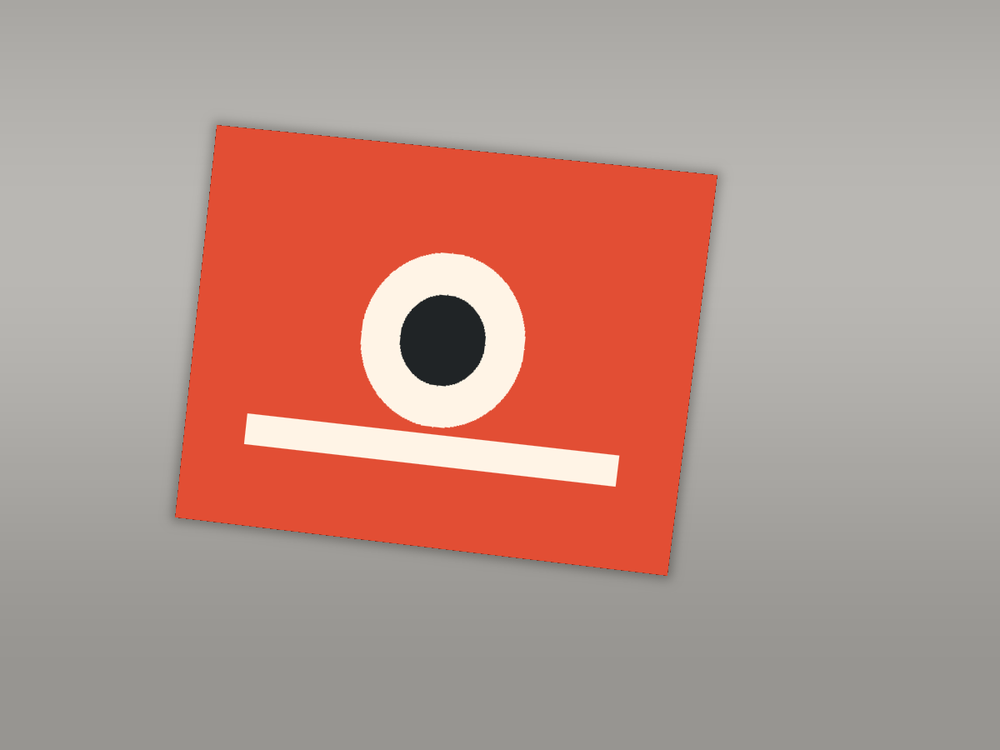

# Sticky

Your stickers, wherever you go.

Sticky turns a photograph of a sticker you already own into artwork you can print or cut again. Upload a picture of one sticker, or of a laptop covered in them. Sticky finds the outlines, straightens a quadrilateral sticker, removes the surface behind it, and exports a transparent PNG, a real vector SVG when that fits the artwork, a cut outline, and an exact-size PDF.

No account. No API key. Photographs are processed on the machine running Sticky and are not sent to a third party.



The landing page compares that photograph with the restored cut-out in `apps/web/public/demo/after.png`.

## What you can do

1. Upload a JPG, PNG, WebP, or HEIC photo. Phone camera rolls work. EXIF orientation is corrected.
2. Let Sticky propose outlines, or draw a rectangle, polygon, four corners, or a brush mask.
3. Straighten a four-sided sticker. Irregular shapes stay irregular.
4. Remove the background while keeping white ink that does not match the surface, and keeping die-cut holes that do.
5. Adjust cleanup, edges, color, and sharpness. Every slider reprocesses from the source crop.
6. Keep a faithful transparent PNG, or trace editable paths with [VTracer](https://github.com/visioncortex/vtracer).
7. Set the size in millimetres, centimetres, or inches. Add a border and a cutting outline.
8. Place one or more stickers on a Letter or A4 sheet and download a PDF at the real page size.
9. Download PNG, SVG, cut SVG, or a ZIP with a manifest.

## Stack

| Piece | Choice |
| --- | --- |
| Web | Next.js App Router, React, TypeScript, Tailwind |
| API | FastAPI |
| Vision | OpenCV, NumPy, Pillow |
| Vectors | VTracer 0.6.11 |
| PDF | ReportLab |
| SVG checks | defusedxml, CairoSVG |

The processing code lives in `services/api/app/processing` and does not import FastAPI, so a desktop app or CLI can call the same pipeline.

## Local setup

You need Python 3.12, Node.js 22, and Cairo (CairoSVG uses it to compare vector output with the raster).

```bash
sudo apt-get install -y libcairo2 libpango-1.0-0 python3.12-venv
python3 -m venv services/api/.venv
services/api/.venv/bin/pip install -r services/api/requirements-dev.txt
npm install
```

Two terminals:

```bash
# API — http://localhost:8000/docs
services/api/.venv/bin/uvicorn app.main:app --app-dir services/api --reload --port 8000

# Web — http://localhost:3000
NEXT_TELEMETRY_DISABLED=1 npm run dev --workspace @sticky/web
```

Or both at once: `bash scripts/dev.sh`.

Copy `.env.example` if you want to change limits. The defaults work with no `.env` file.

Try an example from the home page, or upload `examples/samples/rectangle.png`.

## Docker

```bash
docker compose up --build
```

The site is at http://localhost:3000 and the API at http://localhost:8000. Photos are stored in the `sticky-data` volume and deleted after `STICKY_ARTIFACT_TTL_HOURS` (default 6).

`NEXT_PUBLIC_API_URL` is baked into the web image at build time. The compose file sets it to `http://localhost:8000`, which is what the browser on your machine should call.

## Tests

```bash
cd services/api && .venv/bin/pytest
npm run build --workspace @sticky/web
```

The Python tests build synthetic photographs with known geometry and check detection, perspective correction, white-ink preservation, die-cut holes, cutline closure, real SVG paths, PDF page size, and two full API flows: one sticker to PNG and SVG, and several stickers to a Letter PDF.

Regenerate the sample images with `npm run samples`.

## Deploy

The web app can be deployed on its own (Vercel or any Node host). The API is a separate container. See [docs/DEPLOYMENT.md](docs/DEPLOYMENT.md).

Set `NEXT_PUBLIC_API_URL` to the public API origin before building the web app, and set `STICKY_CORS_ORIGINS` on the API to the web origin.

## Environment

| Variable | Default | Purpose |
| --- | --- | --- |
| `STICKY_DATA_DIR` | `/tmp/sticky-data` | Temporary photos and exports |
| `STICKY_MAX_UPLOAD_MB` | `25` | Upload limit |
| `STICKY_MAX_MEGAPIXELS` | `40` | Decode limit |
| `STICKY_PREVIEW_MAX_DIMENSION` | `1400` | Long side while editing |
| `STICKY_FINAL_MAX_DIMENSION` | `4096` | Long side for final processing |
| `STICKY_VECTOR_MAX_DIMENSION` | `1200` | Long side passed to VTracer |
| `STICKY_ARTIFACT_TTL_HOURS` | `6` | Delete old uploads |
| `STICKY_CORS_ORIGINS` | localhost:3000 | Allowed browser origins |
| `STICKY_SEGMENTATION_BACKEND` | `opencv` | `opencv` or `rembg` |
| `STICKY_ENABLE_REMBG` | `false` | Allow the optional model backend |
| `STICKY_JOB_WORKERS` | `2` | Background jobs |
| `NEXT_PUBLIC_API_URL` | `http://localhost:8000` | API origin baked into the web app |
| `NEXT_TELEMETRY_DISABLED` | set in dev scripts | Turns off Next.js telemetry |

## Cricut and printing

Short version, also shown in the app at `/guide`:

- Print the PDF at **100% / Actual Size**. Fit to Page changes the sticker size.
- For multicolor stickers, import the transparent PNG into Cricut Design Space and use **Print Then Cut**. Sticky does not generate Cricut registration marks.
- SVG paths import as cuts unless you change the operation. Use the cut SVG for the silhouette and the vector SVG only when the artwork is actually paths you want to cut or edit.
- A hybrid SVG contains an embedded PNG plus a cut path. The file says so. It is not a full vectorization.
- Machine size limits depend on the Cricut model and the print settings. Sticky does not pretend there is one universal limit.

## Privacy

- There is no account, analytics, or telemetry in Sticky.
- Processing does not call OpenAI, Replicate, or any other hosted model.
- Uploads are checked by file content, size, and pixel count. SVG output is sanitized (no scripts, no external links).
- Files live in `STICKY_DATA_DIR` and are removed after the TTL. The browser stores project settings and artifact ids in `localStorage`, not the photo bytes.
- If you use a Sticky server run by someone else, that operator can see uploads. Run it yourself if the photos should stay with you.
- Next.js has its own telemetry. The dev script and Docker image set `NEXT_TELEMETRY_DISABLED=1`.

## How restoration works

See [docs/ARCHITECTURE.md](docs/ARCHITECTURE.md) for the pipeline, what is deterministic, and the optional `rembg` model license.

Short version: OpenCV finds regions that differ from the border and from a blurred local background. A quadrilateral with a rectangular silhouette can be warped with a homography. Segmentation compares pixels with the surface color outside the selection, so white artwork on a dark laptop stays opaque and a hole that shows the laptop stays clear. GrabCut runs when that contrast is too low. Cleanup is ordinary color, denoise, and a clamped unsharp mask. VTracer traces paths. If the vector rendering drifts from the raster, Sticky says so and keeps Faithful mode available.

## Known limits

- Sticky cannot recover a sticker’s real-world size from pixels. You type the size you want.
- Touching or overlapping stickers may come back as one region. Split them with the polygon or brush.
- Severe glare, blur, and occlusion are reported, not invented away. There is no generative fill.
- Vector traces are capped around 1200 px on the long side so files stay editable. Fine type and gradients often belong in Faithful mode.
- Sheet layout packs bounding boxes. The box includes the border and rotation, and spacing is measured between boxes.
- `rembg` is implemented as a swappable backend and left off. Enabling it downloads weights on first use.
- Preview edits use a smaller working image. Downloads reprocess at the final size, up to 4096 px on the long side. Scaling beyond the photo does not add real detail, and the export says so.

## Contributing

Issues and pull requests are welcome. Please:

1. Keep the processing library independent of the HTTP layer.
2. Add a synthetic-image test when you change detection, segmentation, vectorization, or export.
3. Do not add accounts, analytics, or a required hosted model.
4. If you enable a new model, document its license, size, and that it is opt-in.
5. Run `pytest` and `npm run build --workspace @sticky/web`.

## License

MIT. See [LICENSE](LICENSE). VTracer and the other libraries keep their own licenses. Model weights are not included.
